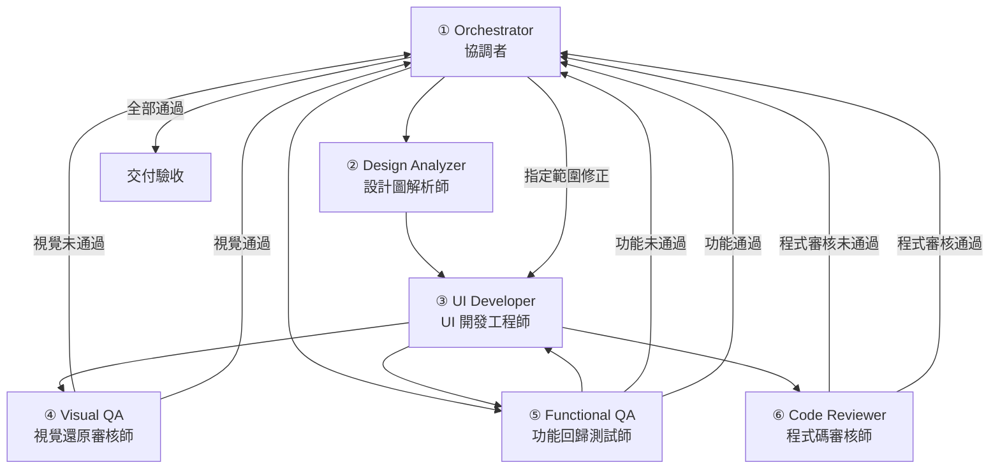

# Web UI 重新設計：OpenCode 多 Agent 團隊編排設計指南

## 文件目的

本文件整理如何將原本的「協調者、開發者、審核者」三 Agent
架構，擴充為適合依照設計公司提供的 PNG／JPEG 設計圖，重新設計既有 Web UI
的多 Agent 團隊。

核心目標：

1.  **設計還原度**：盡可能精準還原設計圖片，包括版面、尺寸、間距、字體、顏色與元件樣式。
2.  **功能完整性**：保留舊系統的功能、事件、資料流、API 契約與操作邏輯。
3.  **持續開發能力**：UI 改版完成後，仍能沿用同一組 Agent
    開發、調整及審核後續功能。

建議採用 **6 個專業 Agent + 雙重品質審核迴圈**。設計分析、UI
實作、視覺審核、功能回歸與程式碼審查各自分工，避免由同一個 Agent
同時實作及自行判定品質。

------------------------------------------------------------------------

## 一、Agent 團隊架構

### 1.1 六個 Agent 的角色

  ----------------------------------------------------------------------------------------------------------------------------------------
  編號              Agent                      核心任務                                                 檔案修改權限建議
  ----------------- -------------------------- -------------------------------------------------------- ----------------------------------
  1                 Orchestrator（協調者）     任務規劃、派工、狀態管理、品質門檻、修正順序與最終整合   原則上不直接修改 UI

  2                 Design                     分析設計圖片、拆解版面與元件、抽取設計規格               唯讀原始碼；可產生規格文件
                    Analyzer（設計圖解析師）                                                            

  3                 UI Developer（UI           依照設計規格實作新 UI，並整合舊有功能                    可修改指定前端檔案
                    開發工程師）                                                                        

  4                 Visual                     取得瀏覽器截圖、與設計原圖比對、提出具體修正項目         唯讀產品程式碼
                    QA（視覺還原審核師）                                                                

  5                 Functional                 驗證既有功能、事件、API、路由、表單與操作流程            唯讀產品程式碼；測試產物另行授權
                    QA（功能回歸測試師）                                                                

  6                 Code                       審查程式品質、相容性、可維護性、效能與安全性             唯讀產品程式碼
                    Reviewer（程式碼審核師）                                                            
  ----------------------------------------------------------------------------------------------------------------------------------------

### 1.2 團隊架構圖



這是角色與回報關係示意圖，不代表所有 Agent
都必須依序執行。功能盤點與設計圖解析可以並行；視覺、功能及程式碼審核則可在同一個開發版本完成後分別執行。

### 1.3 為什麼需要獨立的 Visual QA？

Visual QA 必須與 UI Developer 分離。

如果同一個 Agent
同時負責畫面實作及自行判定是否還原正確，容易因為熟悉自己的實作而忽略偏差。獨立審核者應以設計原圖、實際瀏覽器截圖及差異證據為依據，不應只憑主觀描述判定通過。

------------------------------------------------------------------------

## 二、UI 改版的完整工作流程

建議拆成六個階段。最重要的原則是：**先建立既有功能基準，再進行 UI
轉換；視覺與功能必須分開驗證。**

### 階段 1：建立既有功能基準

由 Functional QA 盤點舊頁面：

-   按鈕、表單、欄位與驗證規則。
-   API 呼叫、參數、回傳資料與錯誤處理。
-   Vuex 狀態、元件事件與父子元件互動。
-   路由、頁面切換、查詢條件與資料呈現。
-   使用者操作流程、例外情境與權限限制。

使用 Playwright 建立關鍵操作的特徵測試（Characterization
Tests），先記錄舊系統目前的實際行為，避免改版時不小心改變原有邏輯。

**預期產出：**

-   `functional-baseline.md`
-   功能測試案例
-   舊版操作流程與必要截圖
-   API／事件／狀態對照資料

### 階段 2：設計圖逆向解析

由 Design Analyzer 分析設計公司提供的 PNG／JPEG：

-   畫面整體尺寸與主要區域。
-   Header、Sidebar、Toolbar、Content 等區塊。
-   元件座標、寬高、對齊方式與間距。
-   Padding、Margin、Gap。
-   字體、字級、字重、行高與文字顏色。
-   背景色、邊框、圓角、陰影與圖示。
-   元件狀態及可能的互動方式。

**預期產出：**

-   `design-spec.md`
-   `design-tokens.json`
-   元件拆解與新舊元件對照表
-   不確定事項與待確認清單

設計分析結果必須區分三種資訊：

1.  **圖片可確認**：可從圖片直接觀察或量測。
2.  **量測推估**：根據圖片比例、像素或常見版型推估。
3.  **需要設計決策**：例如
    Hover、Focus、RWD、捲動行為等，單張靜態圖片無法確認的內容。

不要把推估資訊當成設計公司已確認的規格。

### 階段 3：UI 實作與功能遷移

由 UI Developer 依照設計規格及既有功能基準進行實作：

-   優先重用舊有元件、事件、API Service 與業務邏輯。
-   先建立共用 Design Tokens，再實作共用 UI 元件。
-   依照頁面區域或元件分批修改。
-   不要為了畫面還原而擅自更動 API 契約或資料流程。
-   每次修改應有明確範圍，避免一次改動過多區域。

**預期產出：**

-   新 UI 程式碼
-   共用元件與樣式
-   設計規格對應紀錄
-   修改檔案清單與實作說明

### 階段 4：視覺差異比對循環

由 Visual QA 使用瀏覽器取得實際畫面，與設計原圖進行比對。

建議產出：

-   `actual.png`：實際瀏覽器截圖。
-   `overlay.png`：設計圖與實際截圖疊圖。
-   `diff.png`：像素差異圖。
-   `visual-report.md`：差異位置、嚴重程度及修正建議。

Visual QA 未通過時，回報協調者，由協調者指定 UI Developer
修正。修正後重新截圖、比對，直到符合驗收條件或達到需要人工決策的情況。

### 階段 5：功能回歸與程式碼審查

兩條審核線分開執行：

**Functional QA**

-   路由與頁面切換。
-   API 呼叫及資料呈現。
-   表單輸入、驗證與送出。
-   按鈕、事件及元件互動。
-   Vuex 狀態與資料流。
-   權限、錯誤處理及例外流程。

**Code Reviewer**

-   程式正確性及相容性。
-   元件拆分與重複程式碼。
-   CSS 作用範圍與樣式污染。
-   效能、可維護性及安全性。
-   是否有不必要的架構或依賴變更。

### 階段 6：協調者整合與交付

協調者確認以下項目均符合條件，才可結案：

-   視覺審核通過。
-   功能回歸測試通過。
-   程式碼審查通過。
-   沒有未處理的高優先級問題。
-   所有修改與測試結果均有紀錄。

### 2.1 審核失敗時的派工規則

  審核結果             協調者處理方式
  -------------------- ----------------------------------------
  UI 與設計圖不一致    交回 UI Developer 修改畫面
  既有功能失效         交回 Developer 修正邏輯或事件串接
  程式品質不通過       交回 Developer 重構指定範圍
  視覺通過、功能失敗   保留已通過的視覺版本，最小範圍修正功能
  功能通過、視覺失敗   不重寫業務邏輯，只修正畫面
  全部通過             整合審核結果並交付

建議同一問題連續修正三輪仍未改善時，先停止自動修改，由協調者重新分析原因，避免
Agent 無限制循環，或反覆破壞已完成的區域。

------------------------------------------------------------------------

## 三、提高 UI 設計還原度的關鍵

增加 Agent 數量不會自動提高還原度。真正重要的是 Design Analyzer 與
Visual QA 是否具備明確的工作契約。

### 3.1 Design Analyzer：將圖片轉換成可執行規格

設計解析師不能只描述「左側有選單，右側有內容」，而是應盡可能量測與記錄：

-   畫布尺寸及比例。
-   區域座標與寬高。
-   元件位置與對齊方式。
-   Padding、Margin、Gap。
-   字體、字級、字重、行高。
-   顏色、邊框、圓角、陰影。
-   圖示與圖片尺寸。
-   可辨識的元件狀態。

每個規格可記錄來源、量測值、信心程度及備註。圖片無法確認的項目應標記為待確認。

### 3.2 Visual QA：以實際瀏覽器畫面作為驗收證據

建議同時建立兩種比對：

**A. 設計稿比對**

將設計原圖與瀏覽器產出的 `actual.png`
對齊，再使用疊圖、差異圖或影像分析找出差異。

**B. 畫面回歸比對**

使用 Playwright `toHaveScreenshot()`
比對本次程式與先前核准的網頁截圖，防止後續修改破壞已完成的 UI。

兩者用途不同。Playwright
第一次建立的快照，預設是網頁本身的截圖，不會自動把設計公司的 PNG
當成標準答案。

### 3.3 視覺審核報告格式

以下為報告格式示例，數值僅供說明：

``` text
視覺檢驗結果：FAIL
頁面：/chat
Viewport：1440 × 900

P1｜主要版面錯位
左側選單寬度 268px，設計目標約 240px。
建議縮小 28px。

P2｜間距異常
標題與第一個內容區塊間距多約 12px。

P2｜字體差異
按鈕文字粗細及行高與參考圖不一致。

修正範圍：
限定 Sidebar、Header 樣式及文字 Token。
不調整 API 與業務邏輯。
```

正式報告應由實際截圖與比對結果產生，不可使用範例數值冒充實測結果。

### 3.4 驗收指標建議

視覺驗收可同時考慮：

1.  差異像素比例。
2.  關鍵區域位置與尺寸。
3.  文字、字體及元件樣式。
4.  疊圖與差異圖的人工確認。
5.  不同頁面狀態與 Viewport 的一致性。

例如，先以低於 2%
的差異像素比例作為試行目標，再依字體、圖像、瀏覽器渲染及實際需求調整。這不等於宣稱達成
98% 的設計還原度。

單張靜態設計圖也無法保證所有互動狀態與響應式畫面都能達到 100% 一致。

------------------------------------------------------------------------

## 四、OpenCode V2 Agent 配置範例

以下是角色與權限的配置起點。實際使用前，應依安裝的 OpenCode V2
版本確認設定格式、權限規則及工具名稱。

範例將協調者設定為 Primary Agent，其他五個角色設定為
Subagent。協調者負責派工及驗收，專業 Agent 負責各自工作。

### 4.1 `opencode.jsonc`

``` jsonc
{
  "$schema": "https://opencode.ai/config.json",
  "default_agent": "ui-orchestrator",
  "agents": {
    "ui-orchestrator": {
      "description": "UI 改版協調者",
      "mode": "primary",
      "system": "你負責既有系統的 UI 改版。先建立功能基準，再解析設計圖、分派 UI 開發、視覺審核、功能測試及程式碼審核。審核失敗時，只派工修改失敗範圍，不准忽略未解決的問題。所有審核通過後才可結案。不得自行修改 UI。",
      "permissions": [
        { "action": "edit", "resource": "*", "effect": "deny" },
        { "action": "subagent", "resource": "*", "effect": "deny" },
        { "action": "subagent", "resource": "design-analyzer", "effect": "allow" },
        { "action": "subagent", "resource": "ui-developer", "effect": "allow" },
        { "action": "subagent", "resource": "visual-qa", "effect": "allow" },
        { "action": "subagent", "resource": "functional-qa", "effect": "allow" },
        { "action": "subagent", "resource": "code-reviewer", "effect": "allow" }
      ]
    },
    "design-analyzer": {
      "description": "解析設計圖片，制定 UI 規格",
      "mode": "subagent",
      "system": "分析 PNG/JPEG 設計圖，辨識版面、元件、尺寸、位置、字體、顏色和間距。輸出結構化設計規格。所有無法由圖片確認的資訊都要標記為推估或待確認。不得修改原始碼。",
      "permissions": [
        { "action": "edit", "resource": "*", "effect": "deny" }
      ]
    },
    "ui-developer": {
      "description": "依設計規格實作 UI 並保留舊功能",
      "mode": "subagent",
      "system": "你是前端 UI 工程師。依設計規格修改既有 UI，優先重用元件、事件和業務邏輯。不可擅自修改 API 契約、資料流程或既有功能。每輪只修正指定差異，並回報修改檔案與驗證結果。"
    },
    "visual-qa": {
      "description": "比對設計圖與瀏覽器畫面",
      "mode": "subagent",
      "system": "你是獨立視覺審核師。必須根據設計原圖、相同尺寸的瀏覽器截圖及差異證據檢查布局、尺寸、間距、文字和色彩。每個問題都要提供位置、嚴重程度、證據及建議修正方式。不可自行修改 UI。沒有實際截圖不得宣告通過。",
      "permissions": [
        { "action": "edit", "resource": "*", "effect": "deny" }
      ]
    },
    "functional-qa": {
      "description": "保護既有功能及執行回歸測試",
      "mode": "subagent",
      "system": "驗證新 UI 與舊系統在相同測試條件下的功能等價性。檢查路由、API、表單、驗證、事件、狀態和操作流程。任何功能回歸失敗均標記 FAIL，並提供重現步驟。不得修改產品程式碼。",
      "permissions": [
        { "action": "edit", "resource": "*", "effect": "deny" }
      ]
    },
    "code-reviewer": {
      "description": "獨立審核 UI 改版程式碼品質",
      "mode": "subagent",
      "system": "審查修改內容的正確性、相容性、重複程式碼、樣式污染、可維護性、效能和安全性。回報具體檔案與問題，不得修改程式碼。",
      "permissions": [
        { "action": "edit", "resource": "*", "effect": "deny" }
      ]
    }
  }
}
```

> 注意：這份範例是角色與基本權限設計起點，不代表已完成全部自動化。仍需建立
> Playwright
> 測試、影像差異腳本、交付文件與協調者驗收規則。讀取、執行命令及瀏覽器工具的權限，也要依實際環境進一步收斂。套用前應以目前安裝版本的官方
> Schema 驗證。

### 4.2 OpenCode V1 與 V2 的差異提醒

如果仍使用 OpenCode V1，需特別留意 V1 與 V2 的 Agent
設定結構不同。不要將 V2 設定直接貼到 V1
設定檔。請以目前安裝版本的官方文件為準。

------------------------------------------------------------------------

## 五、建議搭配的 Skills 與工具

原則是：**Agent 負責角色與決策，Skill 負責可重複執行的專業方法。**

### 5.1 建議工具

  ------------------------------------------------------------------------------------------
  工具                     用途                                   建議使用時機
  ------------------------ -------------------------------------- --------------------------
  Playwright／Playwright   瀏覽器操作、截圖、互動測試、功能回歸   UI
  MCP                                                             開發、視覺驗收、功能測試

  Chrome DevTools MCP      檢查 DOM、CSS、Console、Network 與效能 Visual QA
                                                                  發現異常後追查原因

  Pixelmatch               產生像素差異圖                         設計原圖與實際截圖比對
  或同類影像差異工具                                              

  ImageMagick              圖片尺寸處理、疊圖及影像轉換           視覺比對前處理
  或同類影像處理工具                                              
  ------------------------------------------------------------------------------------------

工具選擇需考量 OpenCode 版本、MCP 支援方式、執行環境及專案安全政策。

### 5.2 建議建立的四個 Skill

可放在專案的 `.opencode/skills/` 目錄：

  Skill                    服務對象          職責
  ------------------------ ----------------- ----------------------------
  `design-to-spec`         Design Analyzer   設計圖片轉成結構化規格
  `ui-component-mapping`   UI Developer      新舊元件對照與既有元件復用
  `visual-regression`      Visual QA         截圖、疊圖、差異比對與報告
  `legacy-regression`      Functional QA     既有功能盤點與回歸測試

### 5.3 Playwright MCP 安裝示例

若目前 OpenCode 環境支援此命令，可參考：

``` bash
opencode mcp add playwright -- npx -y @playwright/mcp@latest
opencode mcp list
```

請依目前版本的 MCP 設定方式及執行環境調整。若使用具備內建 Browser 的
OpenCode 桌面環境，也可先使用其瀏覽器能力，再以 Playwright Test
建立可重現的自動測試。

------------------------------------------------------------------------

## 六、提供給協調者的 UI 改版啟動 Prompt

以下 Prompt 可作為每次啟動 UI 改版工作的任務指令。

``` text
我要依照設計公司提供的 PNG/JPEG 介面設計圖，改造既有的 Web UI。

【核心目標】
1. 新 UI 必須盡可能精準還原設計圖片。
2. 保留所有既有功能、操作邏輯、API、事件與資料流。
3. 優先重用既有元件，避免無必要的架構重寫。
4. 改版後仍須支援持續的功能新增與調整。

【Agent 執行流程】

第一階段：建立既有功能基準
請 Functional QA 盤點既有功能，建立功能基準及可執行的回歸測試。

第二階段：解析設計圖片
請 Design Analyzer 分析設計圖片，輸出 UI 規格、設計 Token、元件拆解和不確定事項。

第三階段：UI 實作
請 UI Developer 對照既有程式與設計規格，規劃元件復用及最小修改方案，再分區實作新 UI。

第四階段：視覺差異比對
請 Visual QA 使用瀏覽器取得相同 Viewport 的實際截圖，與設計原圖進行差異比對。找出最明顯的視覺差異，附上證據和具體修正建議。

第五階段：修正與回歸
如果 Visual QA 未通過，請 UI Developer 僅修正指定差異，再重新執行視覺比對。
已通過的功能與 UI 區域應保持不變。

請 Functional QA 執行完整功能回歸測試；Code Reviewer 獨立審查程式品質。

第六階段：最終驗收
所有審核結果由協調者整合，確認通過後才可結案。

【驗收規則】
- 視覺差異未達驗收標準，不得宣稱 UI 完成。
- 原有功能如有回歸失敗，不得交付。
- 不得為了還原畫面而破壞功能或可維護性。
- 不得虛構測試、截圖或還原度數據。
- 同一問題多次修正無效時，停止盲目重試，先分析原因。
- 所有重要問題解決後才可結案。

【交付內容】
1. 視覺差異結果。
2. 功能測試結果。
3. 程式碼審查結果。
4. 剩餘限制與待確認事項。
5. 修改檔案清單。
```

------------------------------------------------------------------------

## 七、既有前端專案的額外注意事項

若本次仍是既有的 Nuxt 2 + Vue 2 + Vuex + Vuetify 1.5
專案，建議增加以下兩條強制規則。

### 7.1 限制 UI Developer 的修改範圍

原則上優先修改：

-   Vue Template。
-   局部 CSS／SCSS。
-   必要的展示型元件。
-   共用 UI 元件與 Design Tokens。

不要主動修改：

-   Vuex 核心狀態管理。
-   API Service 與 API 契約。
-   核心商業邏輯。
-   與本次 UI 改版無關的路由或資料流程。

若確實需要修改上述項目，必須先提出原因、影響範圍及測試計畫，經協調者確認後再執行。

### 7.2 建立既有功能保護機制

功能測試不能只確認按鈕能否點擊，還應涵蓋：

-   元件事件是否正確觸發。
-   Vuex 狀態是否正確更新。
-   表單驗證是否維持原有規則。
-   路由切換與參數是否正確。
-   API 呼叫與資料呈現是否一致。
-   錯誤處理及例外流程是否仍可正常運作。

如果舊功能沒有先建立測試基準，再高的視覺還原度都無法證明改版安全。

------------------------------------------------------------------------

## 八、最終編排建議：共用一組 Agent，提供兩種工作模式

不需要維護兩套完全不同的 Agent 團隊。建議共用同一組六個
Agent，依任務類型選擇啟用角色。

### 模式 A：UI 改版模式

**主要啟用：六個 Agent。**

適用情境：

-   第一次依設計圖重新製作頁面。
-   大規模版面與元件調整。
-   設計 Token 建立。
-   視覺精修與設計稿驗收。

Design Analyzer、UI Developer、Visual QA 是主要工作核心；Functional QA
負責保護既有功能，Code Reviewer 負責獨立品質審查。

### 模式 B：一般功能開發模式

**主要啟用：協調者、開發者、審核者。**

適用情境：

-   新增一般功能。
-   修改既有業務邏輯。
-   修正 API 或資料處理。
-   小範圍 UI 調整。

只有涉及 UI 的修改才呼叫 Visual QA；不需要每次都重新分析整份設計稿。

### 最終建議

最值得增加的兩個核心 Agent 是：

1.  **Design Analyzer**：把設計圖片轉換成可執行的規格。
2.  **Visual QA**：以實際瀏覽器畫面建立獨立的視覺修正閉環。

再以 Functional QA 保護既有功能，就能讓原本擅長功能開發的 Agent
架構，同時適用於高還原度的 Web UI 改版。

------------------------------------------------------------------------

## 官方參考資料

-   [OpenCode V2 Agents 文件](https://dev.opencode.ai/v2/docs/agents/)
-   [OpenCode V2 Skills 文件](https://dev.opencode.ai/v2/docs/skills/)
-   [Playwright Visual
    Comparisons](https://playwright.dev/docs/test-snapshots)
-   [Microsoft Playwright
    MCP](https://github.com/microsoft/playwright-mcp)
